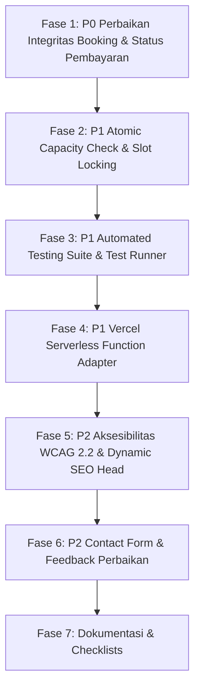

# Rencana Implementasi & Perbaikan Bertahap (Implementation Plan)

Proyek: **Mahawellnerjourney**  
Dokumen Terkait: [AUDIT_REPORT.md](file:///c:/Users/Guntur/OneDrive/Documents/Booking%20Online/AUDIT_REPORT.md)  
Pendekatan: Non-destruktif, terverifikasi otomatis, kepatuhan OWASP ASVS 5.0.0 & WCAG 2.2 AA.  

---

## Urutan Eksekusi Perbaikan



---

## 1. Fase 1: Perbaikan Integritas Booking & Status Transaksi (P0)

- **Masalah**:
  Klien browser memanipulasi status menjadi `paid` dan mencetak voucher "LUNAS" meskipun pembayaran belum terverifikasi oleh server atau gateway.
- **Tindakan**:
  1. Ubah alur submit di `src/pages/booking.js` dan `src/pages/checkout.js`:
     - Status pemesanan awal selalu `pending` (Menunggu Pembayaran / Verifikasi Concierge).
     - Pisahkan status pemesanan (`booking_status`: `PENDING`) dan status pembayaran (`payment_status`: `UNPAID` / `WAITING_CONFIRMATION`).
     - Tampilkan voucher/invoice dengan status jujur: **"RESERVASI SEMENTARA — MENUNGGU VERIFIKASI / PEMBAYARAN"**.
     - Sediakan panduan instruksi pembayaran yang jelas (Transfer Bank / WhatsApp Concierge Direct) tanpa klaim palsu "Pembayaran Berhasil Secara Instan".
  2. Perbaiki `src/pages/invoice.js`:
     - Cegah fallback data palsu `PAID` pada URL `/#/invoice/:id`. Jika data tidak ada di session dan gagal diambil dari database yang terverifikasi, tampilkan pesan status: *"Invoice tidak ditemukan atau sedang menunggu verifikasi reservasi"*.
- **Ketergantungan**: None
- **Kriteria Selesai**:
  - Tidak ada kode browser yang secara sepihak mengubah status menjadi `paid` tanpa otorisasi backend.
  - Pengujian langsung di browser memvalidasi status awal adalah `pending` / `waiting_confirmation`.

---

## 2. Fase 2: Atomic Capacity Check & Concurrency Lock di Backend (P1)

- **Masalah**:
  `POST /api/bookings` di `server/api-handler.js` tidak memverifikasi apakah total peserta pada slot `(booking_date, booking_time)` sudah melebihi kapasitas maksimal `MAX_CAPACITY_PER_SLOT = 8`.
- **Tindakan**:
  1. Di dalam transaksi `withTransaction(db, ...)` pada `server/api-handler.js`:
     - Tambahkan query penghitungan kuota:
       ```sql
       SELECT COALESCE(SUM(pax), 0) AS booked_pax 
       FROM bookings 
       WHERE booking_date = ? AND booking_time = ? 
         AND status NOT IN ('cancelled', 'failed')
       ```
     - Jika `booked_pax + v.pax > MAX_CAPACITY_PER_SLOT`, gagalkan transaksi dengan `HttpError(409, 'ERR_SLOT_FULL', 'Kapasitas slot untuk waktu ini telah penuh.')`.
  2. Pastikan `idempotency_key` dan `order_id` tetap unik dan menolak duplicate submission.
- **Ketergantungan**: Fase 1
- **Kriteria Selesai**:
  - Request bersamaan yang melampaui sisa kuota kapasitas otomatis ditolak dengan kode status 409.

---

## 3. Fase 3: Automated Testing Suite & Test Runner (P1)

- **Masalah**:
  Tidak ada script `npm test` dan pengujian unit/integrasi otomatis di repository.
- **Tindakan**:
  1. Manfaatkan runner native Node.js 24 (`node:test` dan `node:assert`).
  2. Buat folder `test/` dengan suite:
     - `test/security.test.js`: Validasi format nama, email, sanitasi nomor telepon internasional E.164, pencegahan XSS.
     - `test/api-booking.test.js`: Pengecekan kalkulasi harga di server (anti-manipulasi client), validasi tanggal masa lalu, batasan peserta (pax).
     - `test/concurrency-capacity.test.js`: Uji penguncian kuota kapasitas slot (slot collision & overbooking prevention), uji idempotency key ganda.
     - `test/admin-auth.test.js`: Uji perlindungan endpoint admin (penolakan request tanpa Bearer token / token salah, anti brute-force limiter).
  3. Tambahkan script `"test": "node --test test/**/*.test.js"` ke `package.json`.
- **Ketergantungan**: Fase 1, Fase 2
- **Kriteria Selesai**:
  - Perintah `npm test` berjalan secara lokal dan seluruh test case lulus (green / exit code 0).

---

## 4. Fase 4: Adaptor Serverless Vercel untuk API Handler (P1)

- **Masalah**:
  Di Vercel, `server.js` tidak berjalan, sehingga request ke `/api/bookings` menghasilkan 404 pada situs produksi publik.
- **Tindakan**:
  1. Buat folder `api/` dengan file `api/[...routes].js` atau `api/index.js` yang mengekspos handler Vercel Serverless Function standar:
     ```javascript
     export default async function handler(req, res) { ... }
     ```
  2. Sambungkan ke `server/api-handler.js` dengan fallback database in-memory / Supabase sync.
  3. Tambahkan konfigurasi `vercel.json` dengan rewrites bersih:
     ```json
     {
       "rewrites": [
         { "source": "/api/(.*)", "destination": "/api" }
       ]
     }
     ```
- **Ketergantungan**: Fase 2
- **Kriteria Selesai**:
  - Build Vercel mendukung endpoint `/api/*` secara serverless tanpa merusak routing SPA frontend.

---

## 5. Fase 5: Aksesibilitas WCAG 2.2 Level AA & Dynamic SEO Metadata (P2)

- **Masalah**:
  Judul halaman `<title>` dan meta description statis saat bernavigasi antar rute SPA; dialog modal belum mendukung navigasi keyboard dan focus trapping.
- **Tindakan**:
  1. Perbarui `src/router.js`:
     - Tambahkan fungsi pembaruan SEO dinamis (`document.title` dan meta `description`) sesuai rute yang aktif (`Home`, `Layanan`, `Detail Layanan`, `Booking`, `Tentang Kami`, `Hubungi Kami`, `Invoice`).
  2. Perbaiki komponen modal (`src/components/paymentModal.js` dan dialog chatbot di `src/main.js`):
     - Tambahkan atribut aksesibilitas: `role="dialog"`, `aria-modal="true"`, `aria-labelledby`.
     - Tambahkan keyboard listener untuk tombol `Escape` agar modal dapat ditutup dengan mudah.
     - Tambahkan pengembalian fokus keyboard (*focus restoration*) ke elemen pemicu setelah modal ditutup.
- **Ketergantungan**: None
- **Kriteria Selesai**:
  - Navigasi rute memperbarui `<title>` secara instan.
  - Seluruh modal dapat dioperasikan penuh menggunakan keyboard (Tab, Enter, Escape).

---

## 6. Fase 6: Perbaikan Formulir Kontak & UI Feedback (P2)

- **Masalah**:
  Formulir kontak hanya menampilkan native `alert()` yang memblokir browser tanpa menyimpan pesan.
- **Tindakan**:
  1. Di `src/pages/contact.js`:
     - Ganti `alert()` dengan status feedback inline yang elegan (animasi sukses, rincian pesan diterima).
     - Sediakan opsi langsung: kirim via WhatsApp Concierge dengan pesan terformat rapi yang memuat nama dan pertanyaan tamu.
- **Ketergantungan**: None
- **Kriteria Selesai**:
  - Tidak ada lagi pemanggilan `alert()` di seluruh alur kontak.

---

## 7. Fase 7: Dokumentasi Lengkap & Release Verification (P2)

- **Tindakan**:
  1. Hasilkan `SECURITY_CHECKLIST.md` (pemetaan terhadap OWASP ASVS 5.0.0).
  2. Hasilkan `TEST_PLAN.md` (skenario pengujian fungsional, edge case, dan manual QA).
  3. Perbarui `README.md` (panduan instalasi lokal, perintah test, konfigurasi `.env`, dan checklist rilis produksi).
  4. Periksa kembali `.env.example` agar bersih dari secret.
  5. Jalankan `npm test` dan `npm run build` untuk memverifikasi kesiapan rilis.
- **Ketergantungan**: Semua fase sebelumnya
- **Kriteria Selesai**:
  - Seluruh dokumen deliverable lengkap dan build produksi berhasil 100% tanpa error.
